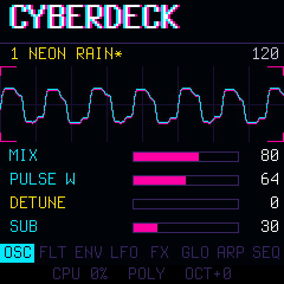
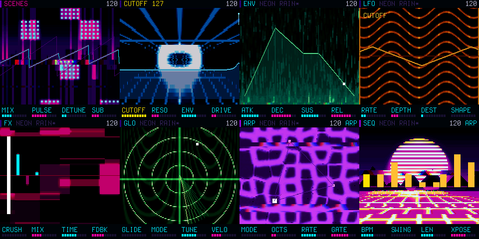

# CYBERDECK

**A four-voice subtractive synth for the M-VAVE FM-1, with an arpeggiator, a 32-step sequencer and a patch mutator.**

Saw, pulse and sub oscillators into a resonant filter, drive, an envelope per voice, one LFO, a bit crusher and a dark
ping-pong delay. Eight patches (NEON RAIN, CHROME BASS, KANEDA, ZAIBATSU, GLITCH ICE, TYRELL, WIRED, DATA MOSH), a neon
HUD with a live oscilloscope, and a HOME button that nudges the patch somewhere new.

<p align="center"></p>

<p align="center"></p>

> **Version 1.0.** Package identity `FM-1_960`. The user manual is **[docs/MANUAL.md](docs/MANUAL.md)**.

## What it does

| | |
| --- | --- |
| **Voices** | 4-voice poly, or mono legato with glide. Saw + detuned pulse (PWM) + sub square, a state-variable low-pass filter with its own envelope and key tracking, drive, an ADSR, velocity |
| **Modulation** | One LFO (triangle, saw, square, sample-and-hold) to cutoff, pitch or pulse width |
| **Effects** | Bit crusher, ping-pong delay with tape-style time smearing, an output limiter |
| **Arpeggiator** | Up, down, up-down, random; 1 to 3 octaves; 1/4, 1/8, 1/16, 1/16 triplet, 1/32; gate; HOLD |
| **Sequencer** | 32 steps with accents, swing, transpose; step record and overdub |
| **Mutate** | Double-tap HOME: four to six knobs take a bounded random step, so the patch stays playable |
| **Scenes** | Tap HOME: every page becomes a neon scene (a city in the rain, a grid corridor, a radar...) with its parameters drawn as light: the filter's curve, the envelope, the echoes, the pattern as a skyline. A loading screen opens the firmware. The art is made in EffectCraft ([assets/art](assets/art)) |
| **Saving** | 8 patch slots, the global settings and the pattern, kept in flash |
| **MIDI** | In from an external keyboard over the **TRS jack** (DIN-to-TRS type A cable) or USB: notes with velocity, pitch wheel, program change, all-notes-off, six CCs. Out over USB: the keys, the arpeggiator and the sequencer |
| **USB audio** | A 16-bit stereo audio input for your computer |

## The panel in short

| Control | |
| --- | --- |
| **EDIT SEL ENV LFO FX GLO** | The OSC, FLT, ENV, LFO, FX and GLO pages; **KNOB 1-4** edit the page |
| **ARP**, **SEQ** | The arpeggiator (ARP again on its page: on, hold, off) and the sequencer page. Hold SEQ: two-part mode on/off (a different sound for the sequence and arp than for the keys); hold ARP: swap |
| **ALGORITHM**, **SELECT** | Cutoff and resonance, on every page |
| **PRESETS**, **SAVE** | Choose a patch; store it |
| **PLAY**, **REC** | Start/stop the pattern; record (step record when stopped, overdub when playing) |
| **HOME** | Tap: parameters <-> scenes. Double-tap: mutate (a tap is a rest while step recording). Hold: panic |
| **OCT- / OCT+** | Octave, plus or minus two |

Everything else is in the [manual](docs/MANUAL.md).

## Install

Install `releases/cyberdeck-1.0.fwsc` with the [FM-1 Firmware Hub](https://fm1.designburgapps.com) in Chrome or Edge,
or over USB:

```sh
python3 tools/fm1_install.py releases/cyberdeck-1.0.fwsc
```

Going back to another firmware, or to the official one, works the same way through the hub. If the FM-1 won't start,
hold **OCT-** while switching it on: the USB rescue, with only the updater running. Installing firmware is at your own
risk; back up your presets first.

## Build it

The app is [firmware/src/cyberdeck.c](firmware/src/cyberdeck.c) and the scenes are [firmware/src/scenes.h](firmware/src/scenes.h). Next to them, `platform.c` and `hal/` are the Felucca /
SLOOP platform as Dinghy carries it (boot, USB, updates, the audio interrupt, settings), and `tables.h` is written by
`tools/gen_tables.py`; the scene art is `firmware/gen/art_plates.h`, made by `tools/make_art.ps1` (below).

You need Linux on x86-64 (or WSL, or Docker on macOS), Python 3 with Pillow, the JieLi toolchain and three files of the
JieLi AC79 SDK. Set up once:

```sh
pip3 install Pillow mido python-rtmidi
tools/get_toolchain.sh                      # JieLi's clang for the chip, to ~/.jieli/toolchain
git clone --depth 1 --branch AC79NN_SDK_V1.2.1_2023-12-13 \
    https://gitee.com/Jieli-Tech/fw-AC79_AIoT_SDK.git ~/fw-AC79_AIoT_SDK
```

`JIELI_TOOLCHAIN` and `AC79_SDK` point elsewhere if your copies live somewhere else. Then:

```sh
tests/run_host.sh tests/demo.txt        # on the computer: build/host/cyberdeck.wav and screen PNGs, in seconds
./build.sh                              # -> build/cyberdeck.fwsc (the build refuses what would brick the FM-1)
./build.sh --release 1.0                # -> build/cyberdeck-1.0.fwsc, identity FM-1_960
python3 tools/fm1_install.py build/cyberdeck.fwsc
```

In the FM-1 Projects workspace the same steps are `.\fm1.ps1 host cyberdeck`, `.\fm1.ps1 build cyberdeck` and
`.\fm1.ps1 install cyberdeck`.

## Tests

Host mode runs `cyberdeck.c` unchanged on the computer from a script of key presses, knob turns and MIDI
([tests/host.c](tests/host.c) lists the commands). It writes the sound as a WAV, the screens as PNGs and a trace of
every voice that starts and stops.

| Script | What it plays |
| --- | --- |
| `tests/demo.txt` | A chord on NEON RAIN with the filter and delay moving, then the mono bass |
| `tests/seq.txt` | The arpeggiator and HOLD, step recording a line, playing it back |
| `tests/mutate.txt` | Mutation after mutation (double taps on HOME) over an arpeggio |
| `tests/scenes.txt` | The loading screen, then every page as a scene, with a chord and knobs turned (screen shots) |
| `tests/scenes_stress.txt` | Every scene with every knob at both ends, chords, arp, recording: it must not crash or read out of range |
| `tests/arp.txt` | The arpeggiator's corners; checked by `tests/check_arp.py` |
| `tests/layer*.txt` | Two-part mode: layering, mono against poly, swap, MIDI out on channel 2, the arp in the layer, a power cycle, loudness against one part; checked by `tests/check_layer.py` (it runs the host build itself) |
| `tests/midi.txt` | MIDI on the TRS jack (raw bytes: running status, real-time bytes inside messages, SysEx, velocity 0, program change, pitch wheel, all notes off) and the notes sent out over USB; checked by `tests/check_midi.py` |

```sh
tests/run_host.sh tests/arp.txt > build/host/arp-trace.txt
python3 tests/check_arp.py build/host/arp-trace.txt
```

The platform's rules (no FPU, no 64-bit division, the audio interrupt's time budget) are in
[docs/RULES.md](docs/RULES.md), and its calls are in [docs/API.md](docs/API.md).

## License and credits

GPL-3.0-only: you may change and share it, and whoever gets the firmware gets its source. Details and third-party parts
are in [LICENSING.md](LICENSING.md).

The platform is Copyright (C) 2026 Leo Kuroshita (@kurogedelic), Hügelton Instruments
([Felucca](https://github.com/hugelton/Felucca)), with [SLOOP](https://github.com/isod89/sloop-fm1)'s changes (isod89).
CYBERDECK starts from [Dinghy](https://github.com/zvenson/dinghy) by zvenson (the app template, host mode and platform docs).
